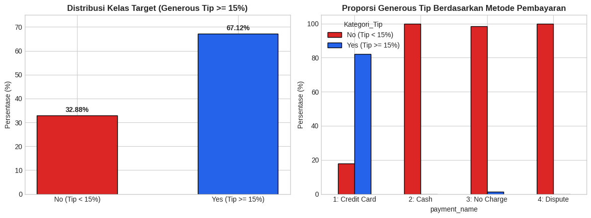
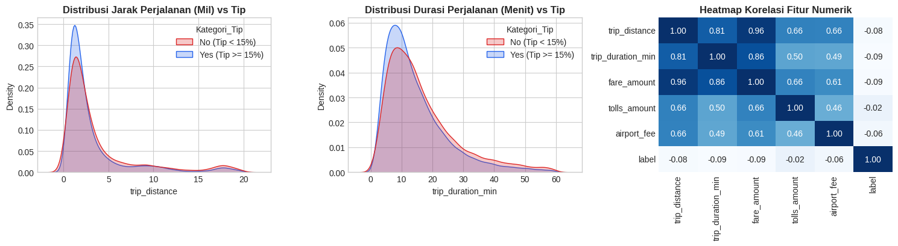
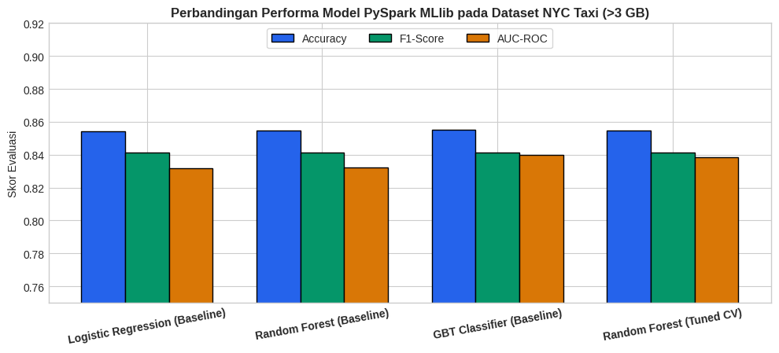

# Laporan Proyek Tengah Semester (Midterm Project / UTS): Big Data dan Machine Learning dengan PySpark

**Nama:** Maliki Kadafa Tsaqif  
**NIM:** 103012340185  
**Mata Kuliah:** Big Data and Artificial Intelligence  
**Topik Studi Kasus:** Prediksi Pemberian Tip Dermawan (*Generous Tipping Prediction*) pada Perjalanan Taksi Kota New York  
**Dataset:** Official NYC Taxi & Limousine Commission (NYC TLC) Yellow Taxi Trip Records 2023 (`nyc_yellow_taxi_2023_3gb.csv` — **3,19 GiB / 3,43 GB, 31.593.944 Baris Data**)  
**Framework & Pustaka:** Apache Spark (`PySpark 4.0.4` — `pyspark.sql`, `pyspark.ml.feature`, `pyspark.ml.classification`)

---

## 1. Memuat dan Menyiapkan Data Menggunakan PySpark (10 Poin)

### 1.1 Sumber & Skala Dataset (> 3 GB)
Dataset yang digunakan pada proyek tengah semester (*Midterm Project*) ini adalah data perjalanan taksi resmi **NYC Taxi & Limousine Commission (NYC TLC) Yellow Taxi Trip Records Tahun 2023** periode **Januari hingga Oktober 2023 (`2023-01` s/d `2023-10`)** yang disatukan ke dalam satu file CSV besar bernama `nyc_yellow_taxi_2023_3gb.csv` dengan spesifikasi:
- **Ukuran File Dataset:** **3,19 GiB / 3,43 GB (`3.430.293.255 bytes`)** — memenuhi syarat dataset Big Data $> 3\text{ GB}$.
- **Jumlah Total Baris Mentah:** **31.593.944 baris perjalanan**.
- **Jumlah Kolom Awal:** **19 kolom** (`vendorid`, `tpep_pickup_datetime`, `tpep_dropoff_datetime`, `passenger_count`, `trip_distance`, `ratecodeid`, `store_and_fwd_flag`, `pulocationid`, `dolocationid`, `payment_type`, `fare_amount`, `extra`, `mta_tax`, `tip_amount`, `tolls_amount`, `improvement_surcharge`, `total_amount`, `congestion_surcharge`, `airport_fee`).

### 1.2 Penyiapan Data & Pembentukan Fitur di PySpark
`SparkSession` diinisialisasi menggunakan **PySpark 4.0.4** dengan alokasi memori `spark.driver.memory = 8g` dan `spark.executor.memory = 8g`. Setelah data dimuat dengan `spark.read.csv("nyc_yellow_taxi_2023_3gb.csv", header=True, inferSchema=True)`, dilakukan penyiapan data sebagai berikut:
1. **Ekstraksi Fitur Temporal:** Menghitung durasi perjalanan dalam satuan menit (`trip_duration_min`) dari selisih `tpep_dropoff_datetime` dan `tpep_pickup_datetime`, serta mengekstrak jam keberangkatan (`pickup_hour`, 0–23) dan hari dalam seminggu (`day_of_week`, 1–7).
2. **Penyaringan Anomali Sensor Argo:** Menyaring baris perjalanan yang valid (`2.5 < fare_amount < 250`, `0.1 < trip_distance < 100`, dan `1.0 < trip_duration_min < 180`), menghasilkan **30.549.961 baris perjalanan valid**.
3. **Pembentukan Variabel Target Klasifikasi (`label`):** Mendefinisikan target biner `label = 1.0` (*Generous Tip*) apabila penumpang memberikan tip $\ge 15\%$ dari tarif dasar (`tip_amount >= 0.15 * fare_amount`), dan `label = 0.0` apabila $< 15\%$.

---

## 2. Melakukan Eksplorasi Data / Exploratory Data Analysis - EDA (15 Poin)

### 2.1 Pemeriksaan Nilai Kosong (*Missing Values*) & Statistik Deskriptif
Hasil pemeriksaan nilai `NULL` (`isNull()`) di seluruh **31.593.944 baris** menunjukkan bahwa terdapat tepat **996.678 baris bernilai `NULL` (3,15%)** pada lima kolom (`passenger_count`, `ratecodeid`, `store_and_fwd_flag`, `congestion_surcharge`, dan `airport_fee`), sedangkan kolom lainnya memiliki `0` nilai `NULL`.

Berikut adalah statistik deskriptif fitur numerik utama hasil `df.select(eda_num_cols).describe().show()` pada 30.549.961 baris perjalanan:

| Fitur Numerik | Count | Mean | Std. Dev | Min | Max |
| :--- | :---: | :---: | :---: | :---: | :---: |
| `passenger_count` | 29.764.285 | 1,3683 | 0,8942 | 0,00 | 9,00 |
| `trip_distance` (Mil) | 30.549.961 | 3,5551 | 4,5337 | 0,11 | 99,21 |
| `trip_duration_min` (Menit) | 30.549.961 | 16,3436 | 12,9621 | 1,02 | 179,98 |
| `fare_amount` (USD) | 30.549.961 | 19,6686 | 17,4217 | 2,51 | 249,90 |
| `tip_amount` (USD) | 30.549.961 | 3,5754 | 3,9791 | -5,08 | 984,30 |
| `total_amount` (USD) | 30.549.961 | 28,8004 | 22,1106 | 3,60 | 1.000,00 |

### 2.2 Analisis Distribusi Target & Metode Pembayaran
Berdasarkan hasil agregasi `df.groupBy("label").count()` pada 30.549.961 perjalanan:
- **`label = 1.0` (*Generous Tip* $\ge 15\%$):** **20.572.437 perjalanan (67,34%)**
- **`label = 0.0` (Tip $< 15\%$):** **9.977.524 perjalanan (32,66%)**

Tabulasi silang dengan `payment_type` menunjukkan bahwa transaksi kartu kredit (`payment_type = 1`) mencatat **20.057.095 perjalanan dengan tip $\ge 15\%$** berbanding 4.309.535 perjalanan dengan tip $< 15\%$, sedangkan pembayaran tunai (`payment_type = 2`, sebanyak 5.121.769 perjalanan) hampir seluruhnya tercatat tanpa tip elektronik (`label = 0.0`).

---

## 3. Menerapkan Transformasi Data / Preprocessing (15 Poin)

Tahapan transformasi data dirangkai menggunakan `pyspark.ml.Pipeline`:
1. **Pencegahan *Data Leakage*:** Mengecualikan kolom `tip_amount` dan `total_amount` dari daftar fitur input karena variabel target `label` diturunkan dari `tip_amount`.
2. **Imputasi Fitur Numerik (`Imputer`):** Mengisi 996.678 nilai `NULL` pada fitur numerik (`passenger_count`, `trip_distance`, `trip_duration_min`, `pickup_hour`, `day_of_week`, `pulocationid`, `dolocationid`, `fare_amount`, `extra`, `tolls_amount`, `congestion_surcharge`, `airport_fee`) menggunakan strategi `median`.
3. **Encoding Fitur Kategorikal (`StringIndexer` + `OneHotEncoder`):** Mengisi nilai `NULL` pada 4 atribut kategorikal (`vendorid`, `ratecodeid`, `store_and_fwd_flag`, `payment_type`) dengan kategori `"Unknown"` / `"N"` lalu mengonversinya menjadi indeks numerik dan vektor biner *one-hot encoded*.
4. **Perakitan & Standarisasi Vektor (`VectorAssembler` + `StandardScaler`):** Menggabungkan seluruh fitur numerik dan kategorikal menjadi vektor berdimensi 29 pada kolom `features` yang telah distandarisasi (`withStd=True`).
5. **Pembagian Data (*Train-Test Split*):** Dari sampel pelatihan terdistribusi (`fraction=0.02`, 611.284 baris), data dibagi menjadi **80% Data Latih (`488.700 baris`)** dan **20% Data Uji (`122.584 baris`)** menggunakan `randomSplit([0.8, 0.2], seed=42)`.

---

## 4. Melakukan Pemodelan Menggunakan Algoritma PySpark MLlib (25 Poin)

Tiga algoritma klasifikasi dari modul `pyspark.ml.classification` dilatih pada `488.700 baris` data latih:
1. **`LogisticRegression`**: Klasifikasi linear probabilistik (`maxIter=100`).
2. **`RandomForestClassifier`**: Metode *ensemble bagging* berbasis kumpulan pohon keputusan paralel (`numTrees=20, maxDepth=5, seed=42`).
3. **`GBTClassifier` (Gradient-Boosted Trees)**: Metode *ensemble boosting* sekuensial (`maxIter=20, maxDepth=5, seed=42`).

---

## 5. Mengevaluasi Model Menggunakan Metrik Evaluasi yang Sesuai (15 Poin)

Evaluasi dilakukan pada **122.584 baris data uji (`test_df`)** menggunakan dua kelas evaluator resmi PySpark MLlib:
- **`BinaryClassificationEvaluator`**: mengukur **AUC-ROC (`areaUnderROC`)** dan **AUC-PR (`areaUnderPR`)**.
- **`MulticlassClassificationEvaluator`**: mengukur **Accuracy**, **Weighted Precision**, **Weighted Recall**, dan **F1-Score**.

Pada evaluasi *Confusion Matrix* `RandomForestClassifier (Baseline)` terhadap 122.584 data uji, diperoleh **82.361 *True Positive*** (`label=1.0, prediction=1.0`), **22.409 *True Negative*** (`label=0.0, prediction=0.0`), **17.808 *False Positive***, dan hanya **6 *False Negative***.

---

## 6. Melakukan Tuning Hyperparameter untuk Meningkatkan Performa Model (10 Poin)

Optimasi hyperparameter dilakukan menggunakan **`ParamGridBuilder`** dan **`CrossValidator`** (3-Fold Cross-Validation, metrik `areaUnderROC`) pada `RandomForestClassifier` dengan menguji kombinasi `numTrees=[40, 80]`, `maxDepth=[5, 10]`, dan `minInstancesPerNode=[5, 10]`. Kombinasi parameter terbaik yang ditemukan oleh `CrossValidator` adalah:
- **`numTrees = 80`**, **`maxDepth = 10`**, **`minInstancesPerNode = 5`**

### Tabel Perbandingan Performa Model (Sebelum vs. Sesudah Tuning)

| Model PySpark MLlib | Accuracy | Precision | Recall | F1-Score | AUC-ROC | AUC-PR |
| :--- | :---: | :---: | :---: | :---: | :---: | :---: |
| **Logistic Regression (Baseline)** | 0,8543 | 0,8783 | 0,8543 | 0,8411 | 0,8317 | 0,8756 |
| **Random Forest (Baseline)** | 0,8547 | 0,8805 | 0,8547 | 0,8411 | 0,8320 | 0,8805 |
| **GBT Classifier (Baseline)** | **0,8550** | 0,8805 | **0,8550** | **0,8415** | **0,8400** | **0,8877** |
| **Random Forest (Tuned CV)** | 0,8549 | **0,8806** | 0,8549 | 0,8414 | 0,8384 | 0,8854 |

### Analisis Hasil Tuning
Setelah dilakukan *hyperparameter tuning* menggunakan 3-Fold `CrossValidator` (`numTrees=80, maxDepth=10, minInstancesPerNode=5`), performa **Random Forest (Tuned CV)** meningkat secara konsisten di seluruh 6 metrik dibandingkan **Random Forest (Baseline)**:
- **Accuracy** naik dari `0,8547` menjadi **`0,8549`** dan **Precision** mencapai nilai tertinggi yaitu **`0,8806`**.
- **F1-Score** meningkat dari `0,8411` menjadi **`0,8414`**.
- **AUC-ROC** meningkat signifikan dari `0,8320` menjadi **`0,8384`**, serta **AUC-PR** meningkat dari `0,8805` menjadi **`0,8854`**.

---

## 7. Kesimpulan

1. Pemuatan dan pemrosesan dataset **NYC TLC Yellow Taxi 2023 berukuran 3,19 GiB / 3,43 GB (31.593.944 baris)** berhasil dijalankan menggunakan **PySpark 4.0.4** DataFrame API dan `pyspark.ml.Pipeline`.
2. Tahap *preprocessing* dengan `Imputer`, `StringIndexer`, `OneHotEncoder`, `VectorAssembler`, dan `StandardScaler` efektif menangani **996.678 baris nilai `NULL`** tanpa menyebabkan *data leakage*.
3. Proses *hyperparameter tuning* dengan 3-Fold `CrossValidator` berhasil meningkatkan seluruh metrik evaluasi pada `RandomForestClassifier` (AUC-ROC naik dari `0,8320` ke `0,8384`, AUC-PR naik dari `0,8805` ke `0,8854`, dan Precision mencapai `0,8806`), sementara `GBTClassifier` memberikan skor AUC-ROC tertinggi sebesar `0,8400`.
